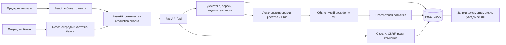
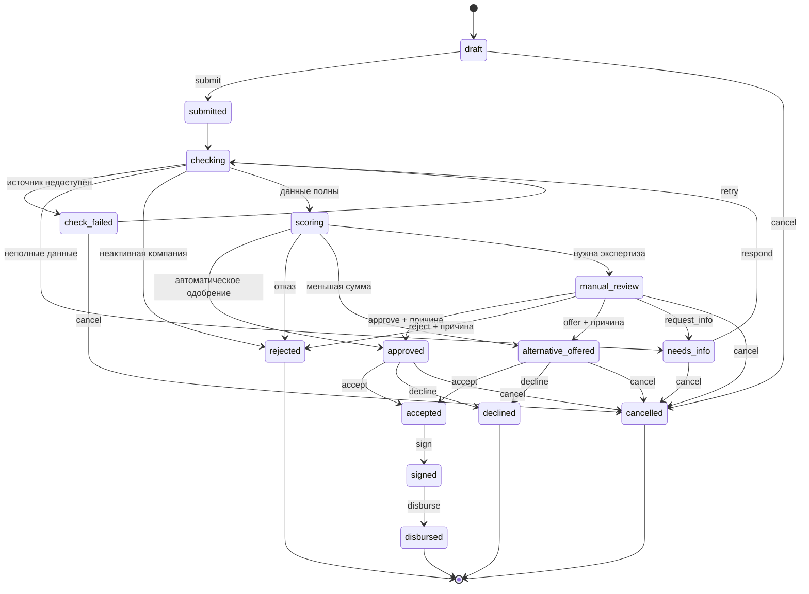
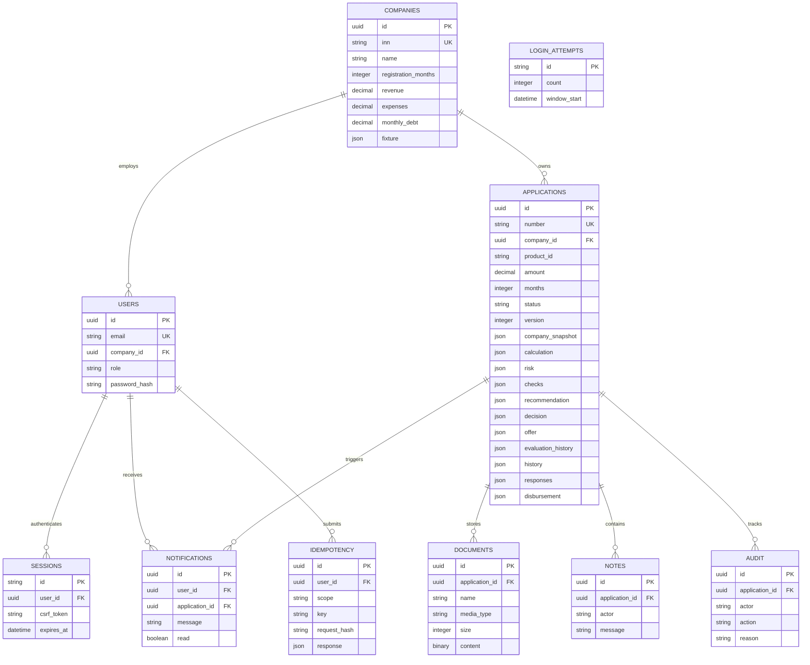

# Архитектура и модель данных

Модульный монолит: React/TypeScript/Vite → FastAPI/Pydantic → SQLAlchemy → PostgreSQL. Alembic управляет схемой. Локальный режим без Docker использует SQLite с теми же моделями. Внешние проверки являются функциями сервера и не требуют сетевого доступа.

## Границы модулей

| Область | Ответственность |
|---|---|
| `frontend/src` | Формы, калькулятор, серверные карточки и списки, роль клиента/банка, уведомления |
| `backend/app/main.py` | HTTP API, маршруты, права на ресурс, транзакционные действия и представления по ролям |
| `backend/app/schemas.py` | Валидация входных полей и финансовых ограничений |
| `backend/app/security.py` | Хеши паролей, сессия, CSRF, роли и граница транзакции |
| `backend/app/lending.py` | Каталог, Decimal-расчет, переходы, локальные проверки, риск и продуктовая политика |
| `backend/app/models.py` | Реляционная модель и сохраненные JSON-снимки |
| `backend/app/db.py` | Соединение, SQLAlchemy session, SQLite-параметры |
| `backend/alembic` | Версионирование схемы БД |

## Транзакции, повторы и конкурентность

Создание и действия используют ключи `Idempotency-Key`, привязанные к пользователю и области операции. Сохраняются хеш запроса и ответ. Повтор с тем же ключом/телом не должен повторять действие; изменение тела с прежним ключом вызывает конфликт. Для нового намерения нужен новый ключ.

Изменения заявки требуют её актуальную `version`. На PostgreSQL значимые действия блокируют строку, на SQLite записи сериализуются через `BEGIN IMMEDIATE`. Состояние, история, аудит, уведомления и запись идемпотентности фиксируются в одной транзакции. Версия защищает от одновременных несовместимых действий. База и документы переживают обычный перезапуск при сохранении хранилища.

Проверки выполняются синхронно. `submitted`, `checking`, `scoring` фиксируются в истории в той же операции; интерфейс получает конечный результат сервера. Отдельных задач и очереди нет, поэтому рестарт не требует восстановления воркеров. Предсказуемый сбой симулятора сохраняется как `check_failed` с явным повтором.

## Состояния

Автор и роль проверяются отдельно от самого графа. Банк не получает права клиента только потому, что видит его заявку. Терминальные состояния не разрешают переиграть выдачу или вернуть заявку в черновик. Полный актуальный набор разрешенных действий задаёт сервер; диаграмма объясняет бизнес-процесс.

## ER-модель

Поля времени и финансовые поля заявки сокращены на диаграмме для читаемости. Реальная схема — `backend/app/models.py` и миграции. `LOGIN_ATTEMPTS` хранит счетчик окна входа. `fixture` — серверные данные симулятора, не часть редактируемого профиля. `product_id` ссылается на каталог в коде; отдельной таблицы продуктов нет. Рекомендации, решения, предложения, истории и выдача вложены в JSON заявки, а не представлены независимыми сущностями.

Документы хранятся бинарно в БД. Это упрощает атомарность и резервное копирование демо. При промышленном объёме нужен объектный storage с отдельными политиками доступа, сканированием и жизненным циклом; сейчас такого сервиса нет.
