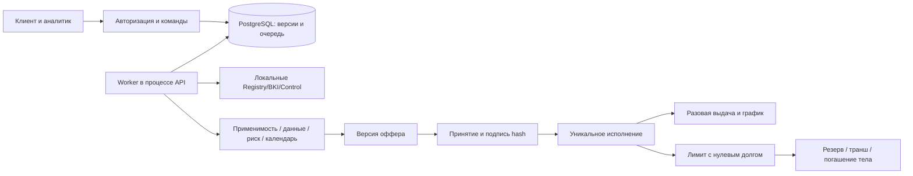

# Архитектура и API кредитного цикла

## Что сохраняется

FastAPI/SQLAlchemy/PostgreSQL, React/TypeScript, Alembic. Существующие таблицы и маршруты раннего прототипа сохранены. Миграция 002 добавляет `credit_v2_records` и `credit_v2_blobs`; 003 — реальное время последней активности сессии. SQLite остается локальной альтернативой.

`credit_v2_records` хранит отдельные версионируемые агрегаты по `kind`, ID, organization_id и revision: Organization, Membership/Authority, Application, Contract, DemoAccount, MonetaryOperation, Quote, Job, DemoClock. У приложения внутри неизменяемые снимки ApplicationVersion, проверки, оценки, решения, версии оффера, согласия, задания/ответы, Acceptance, DocumentBundle и SigningSimulation. Файлы имеют отдельные неизменяемые байты с контролем доступа через заявку. Это JSON-агрегаты с индексами организации/типа, а не отдельная SQL-таблица каждой строки предметной модели ТЗ.

- `credit_policy.py` — чистые продуктовые и финансовые правила DEMO_POLICY_1.
- `credit_servicing.py` — чистые даты, аннуитет, ACT/365, лимит и распределение погашений.
- `v2.py` — серверные права, команды, версии, транзакции, очередь и адаптеры.
- `v2_seed.py` — 12 опубликованных профилей, локальные пользователи и полномочия.
- `frontend/src/v2/` — подбор, форма, оценка, банк, оффер/комплект, обслуживание и демочасы.

Сохраняемое задание создается в одной транзакции с подачей/подписью/резервом. Worker работает в процессе API и делает tick каждые 0,5 секунды. Claim — транзакционная блокировка строки часов, которая освобождается при падении процесса; незавершенное задание остается PENDING и продолжается после рестарта. Внешнего сетевого I/O под этой блокировкой нет. Это намеренно консервативная сериализация демокоманд: масштабирование и целевая нагрузка ТЗ отдельно не подтверждены.



## Контракты

Основной UI использует `/api/v2`; те же маршруты кредитного цикла доступны под `/api/v1` для совместимости с базовым путем ТЗ. Старая версия остается под `/api` без номера. Точный контракт — `docs/openapi.json` и работающий `/docs`. Воспроизводимая коллекция: [api-v2.http](api-v2.http).

Сессия: `/api/auth/login` → cookie и csrf_token. Изменения передают `X-CSRF-Token`, `Idempotency-Key`; команды к агрегату — `expected_version`, дополнительно поддерживается `If-Match`. Тот же ключ с тем же payload возвращает исходный ответ до проверки новой revision/истечения quote; другой payload — 409 IDEMPOTENCY_CONFLICT. Деньги — целые `*_kopecks`, ставка — bps, даты ISO. Ответ ошибки содержит `detail` для UI, `error.code`, `error.message`, correlation_id и X-Request-ID. GET не создает выдач и не меняет договорный расчет.

| Операция | Контракт |
|---|---|
| GET `/workspace?organization_id=...` | Часы, проверенные доступные организации/роли, продукты, заявки/договоры, счет и шаблоны. Админ получает только IDs/состояния и задания |
| GET `/products` | Две версии продуктов и PolicyVersion |
| POST `/applications` | `{template_id, organization_id, input?}` — новый синтетический черновик с документами manifest |
| GET `/applications` | `page`, `page_size` (≤50), `status`; `{items,total,page,page_size}` |
| GET `/applications/{id}` | Разрешенная текущая версия и сохраненная история |
| PUT `/applications/{id}` | `{expected_version,input}` — только черновик; сервер не принимает подмену источников, заемщика и кредитной истории |
| POST `/applications/{id}/commands` | `{action,expected_version,...}` — действия ниже |
| POST `/applications/{id}/documents` | multipart `file,kind,expected_version,replaces_id?`; PDF/PNG/JPEG/CSV, ≤10 МиБ / 20 версий |
| GET `/applications/{id}/document-template?kind=statement` | UTF-8 CSV с опубликованными колонками и периодами |
| GET `/documents/{id}/content` | Авторизованная выдача файла как attachment/nosniff, включая старые версии |
| GET `/applications/{id}/bundle` | Комплект принятого оффера: HTML/текст документов и hashes |
| GET `/contracts/{id}` | Договор, текущие остатки, график/линия/транши, счет и операции |
| POST `/contracts/{id}/commands` | Серверные quote и подтверждение финансовой операции |
| POST `/admin/commands` | Демооператор: advance на 1–31 день либо bind_scenario до подачи |

Действия заявки: `consent` (purpose CREDIT_HISTORY / DATA_PROCESSING, confirmed), `revoke_consent`, `submit`, `save_reply`, `respond` (input, message; для H confirm_classification), `claim`, `release` (reason), `request_info` (question, fields), `accept_document` (document_id, reason), `decide` (outcome, reason, public_explanation, candidate_id для измененного варианта), `retry`, `reopen`, `note`, `accept/decline` (offer_id, offer_hash, confirmed), `sign` (bundle_hash, confirmed), `withdraw`.

`decide` доступно только назначенному аналитику в MANUAL_REVIEW; обязательные финансовые/формальные ограничения и C не обходятся. Сотрудник не задает свободную ставку/баланс. Клиентские факты не редактируются банком. Внутренние заметки не входят в клиентский ответ.

Сопровождение: `draw_preview` (amount_kopecks, days, cycle_plan), `repay_preview` (tranche_id, amount_kopecks либо full), `pay_preview` (наступившая строка). Ответ `{quote:{id,contract_revision,clock_revision,on_date,expires_at,amount_kopecks,principal_kopecks,interest_kopecks,...}}`. Подтверждение `draw/repay/pay` передает `quote_id,confirmed:true`. Quote действует пять реальных минут и только на текущих версиях/дате. Сначала нужен новый расчет, если состояние изменилось. `refresh_checks` обновляет локальные основания перед новым траншем; условия договора сохраняются.

Пример:

```http
POST /api/v2/contracts/CONTRACT_ID/commands
X-CSRF-Token: TOKEN
Idempotency-Key: UNIQUE_OPERATION_KEY
Content-Type: application/json

{"action":"repay","expected_version":7,"quote_id":"QUOTE_ID","confirmed":true}
```

## Деньги и конкуренция

Все изменяющие v2-команды и worker берут блокировку часов до чтения ключа повтора и агрегатов; SQLite использует BEGIN IMMEDIATE. В рамках одной транзакции фиксируются счет, тело/резерв, неизменяемая денежная операция, история и итоговый статус. ID первоначального договора детерминирован приложением, ID проводки — логической операцией. Повторный ключ или новая попытка worker не создает вторую выдачу.

Полезные коды: VERSION_CONFLICT, AUTHORITY_REQUIRED, ACTIVE_APPLICATION_EXISTS, MANDATORY_GATES, OFFER_STALE, QUOTE_STALE, CHECKS_STALE, LIMIT_INSUFFICIENT, TRANCHE_MINIMUM, TRANCHE_SLOTS_EXHAUSTED, MATURITY_MISMATCH, INSUFFICIENT_FUNDS, AMOUNT_EXCEEDS_DEBT, EARLIEST_OVERDUE_FIRST, PENDING_FINANCIAL_EXECUTION. Подробные примеры ошибок проверяются серверными тестами.

## Отличия интерфейса команд от буквального ТЗ

Команды объединены в `/commands`, а не представлены отдельным URL для каждого глагола. HTTP-ответ подтверждает сохраненный результат команды; асинхронное выполнение видно по job_id/статусу и polling, отдельный универсальный operation status endpoint не добавлен. Подбор выполняется внутри UI и продолжает данные в серверном черновике; отдельного `/selection/preview` нет. Worker встроен в API, отдельный контейнер worker не нужен для одного локального экземпляра. Эти отличия раскрыты, чтобы не выдавать совпадение бизнес-поведения за буквальное совпадение всех URL ТЗ.


## Общий денежный поток организации

Источник потока идентифицируется на уровне организации, а не договора: для месячного прогноза — период и вид операции, для календаря — стабильный ID источника. Исполненное событие не зачисляется повторно по второй линии или второму кредиту. Календарная оценка учитывает обязательства и резервы всех договоров этой организации. Противоречащий ранее подтвержденному источнику прогноз переводится на уточнение либо отклоняется до транша с `CASHFLOW_CONFLICT`. Совместимость старых событий без нового поля проверена отдельным тестом. Клиентский API удаляет внутреннее обоснование банковского решения; публичное объяснение сохраняется.
